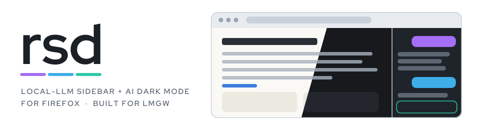

<p align="center">
  <picture>
    <source media="(prefers-color-scheme: dark)" srcset="docs/assets/banner-dark.svg">
    
  </picture>
</p>

<p align="center">
  <a href="https://github.com/lmgw-dev/lmgw"></a>
  <a href="LICENSE"></a>
  
  
</p>

**Inkference** is a Firefox extension built for [**lmgw**](https://github.com/lmgw-dev/lmgw), the local
model gateway. lmgw runs LLMs, TTS and vision models on your own machine. Inkference brings them into the
browser: a sidebar agent that reads and operates the page you're on, right-click actions, read-aloud
and a dark mode that designs a theme for each site.

Nothing leaves your machine unless you point lmgw at a cloud model.

*Ink + inference: a model infers the ink each page needs.*

> **Just want a better dark mode?** That part works with no LLM at all. Install Inkference, click the
> toolbar button, done. Connect lmgw later and every site gets a theme designed for it.

## What it does

### AI dark mode (works without an LLM)
A toolbar button that **compiles** a dark theme per site, caches it, and re-applies it instantly on
every later visit. It works like this:

1. It **probes** every colour rule the page's stylesheets set, with its selector and media query
   (cross-origin sheets included).
2. It **measures** what the viewport actually paints: which fraction reads light, and what paints it.
3. With lmgw connected, the model gets that summary and returns a small **plan**: native theme or
   recolour, the palette, and exceptions. Without lmgw, a built-in theme is used.
4. A deterministic compiler rewrites every colour declaration by its role (background, text,
   border, accent) and keeps hues. The model never writes CSS.
5. It **measures again** and falls back automatically if a site's native dark theme didn't take.

The button tooltip reports the result, e.g. `recolor (76% → 0% of the viewport light)`. With the
built-in theme alone, GitHub, Wikipedia, MDN and anthropic.com go from 84–100% light to 0%. When a
site ships its own dark theme (Stack Overflow), the model finds the hook and uses it.

Right-click the button to recompile or forget a site. `npm run dark-check -- <url>` measures it on
any page.

#### How it compares

Dark Reader is the reference here, and it's excellent. Inkference makes different trade-offs:

- **It checks its own work.** The share of the viewport that still reads light is measured before
  and after, and shown in the tooltip. If a strategy didn't take, it switches to another one by
  itself.
- **It uses the site's own dark theme when there is one.** A root class backing hundreds of rules
  (`body.theme-dark` on Stack Overflow) or `light-dark()` colours (MDN) are switched on as the
  designers built them, instead of being imitated.
- **Colours change by role, not by formula.** Backgrounds, text, borders and accents are mapped
  separately and accents keep their hue. A CSS variable that is a background in one section and text
  in another is detected and rewritten where it's used, so it isn't inverted half the time.
- **Nothing keeps running in the page.** The theme is compiled once per site into a plain user
  stylesheet that Firefox applies like any other CSS. There's no observer re-colouring the page as
  it changes, so a long feed or a busy web app costs no extra script work.
- **The AI part is optional and local.** Without an LLM the built-in theme is used. With lmgw the
  plan is designed per site by a model on your own machine.

Where Dark Reader is ahead:

- **Pages that restyle themselves later.** Dark Reader follows changes live. Inkference compiles
  once, so content a site adds with new styles afterwards can stay light (right-click → recompile).
- **Controls.** No brightness, contrast, sepia or font sliders per site yet. It's on or off.
- **Maturity and reach.** Years of community site fixes, more browsers, more refined handling of
  images and SVG. Inkference is new and Firefox-only for now.

### Page-aware sidebar (needs lmgw)
A chat sidebar (**Ctrl+Shift+L**) with a **Use page** toggle that turns it into an agent for the
current tab. It can *read* the page (summarize, extract, translate, "which of these headlines are
about AI?") and *operate* it (click, type, select, scroll). With **Go off page** it can also navigate
for multi-site errands. Clicks that spend money or can't be undone pause for your approval.

> **Prompt injection.** A page can contain text written to steer the agent. To make the obvious
> leak visible, every `navigate` to a site the task hasn't used yet asks first and shows the full
> URL. Approve once per site per task. This narrows the risk but doesn't remove it: a page could
> still get the agent to type things into a form on that same site. Use the agent on pages you'd
> trust with what's in the conversation.

- **Screen vision.** On canvas/WebGL pages where there's no DOM to read, the agent takes a
  screenshot and clicks by description. lmgw's local vision models (e.g. Gemma) land within a few
  pixels.
- **Settings on your own devices.** Router admin pages often grey out settings in the consumer
  firmware tier. The agent can unlock such a field, set it, and show you the exact request before it
  is sent. Every write is held until you approve it.
- **Script mode.** Builds a per-site script with you that hides or fades the UI on top of videos
  (badges, scrims, sticker layers) and checks itself on later visits when the site changes.

### Right-click actions and read-aloud (needs lmgw)
- **Summarize / Explain / Rewrite / Translate / Ask…** on any selection or page.
- **Read aloud** through lmgw's TTS models. Citation marks, markdown, URLs and emoji are cleaned up
  first, and a reader panel shows exactly what will be spoken.

## Requirements

- Firefox ≥ 140.
- For everything except the built-in dark mode: [lmgw](https://github.com/lmgw-dev/lmgw), reachable
  at `http://127.0.0.1:8787` by default (Options → Gateway base URL). If lmgw has *Require API key*
  on, create a client key under *Usage → Keys* and enter it in the options page.

Inkference talks the OpenAI-compatible API, but it relies on lmgw specifics: model metadata, audio models,
voice presets, token counting. Other endpoints may partly work. They're not tested.

## Install

Download the latest `inkference-<version>.xpi` from
[Releases](https://github.com/lmgw-dev/inkference/releases/latest) and open it in Firefox (or
`about:addons` → gear → *Install Add-on From File*). It's signed by Mozilla and updates itself
from this repo's releases.

## Install from source

```sh
git clone https://github.com/lmgw-dev/inkference.git
cd inkference
npm install
npm run dev     # launches Firefox with a temporary profile and the extension loaded
```

Release Firefox only runs signed add-ons. To sign your own build, get AMO API credentials
(<https://addons.mozilla.org/developers/addon/api/key/>), put them in `.env` as `WEB_EXT_API_KEY` /
`WEB_EXT_API_SECRET` (gitignored), and run `set -a; . ./.env; set +a; npm run sign`. The result lands
in `dist/`.

### Releasing

Push a version tag (`git tag v0.8.0 && git push origin v0.8.0`).
[.github/workflows/release.yml](.github/workflows/release.yml) lints, signs the add-on as unlisted on
AMO, and publishes a GitHub Release with the XPI and the `updates.json` that installed copies poll. The
tag is the version and must be higher than every earlier signature. It needs the repository secrets
`WEB_EXT_API_KEY` / `WEB_EXT_API_SECRET` (`gh secret set -f .env -R lmgw-dev/inkference`).

## Develop

```sh
npm run dev       # web-ext run with auto-reload
npm run lint      # npx web-ext lint --source-dir=src --self-hosted is the stricter gate
npm run mock      # fake router admin, canvas game, dark-mode and video-feed pages on :8088
npm run dark-check -- [--model <id>] <url…>      # dark mode before → after on real pages
npm run ground-check -- --model <id>             # a model's screen-vision aim
npm run script-check -- <url…>                   # Script mode's overlay census
```

The model-driven checks read the gateway key from `LMGW_API_KEY`. There's no build step: `src/` is
plain ES modules that Firefox runs directly. `npm run vendor` re-bundles Readability, marked and
DOMPurify into `src/vendor/` (committed), and is only needed when bumping them.
[CLAUDE.md](CLAUDE.md) has the detailed architecture notes.

## Layout

```
src/
  manifest.json   MV2 manifest
  background/     persistent background page: all gateway I/O, state, page agent, dark-mode
                  engine + compiler, Script mode, read-aloud
  sidebar/        chat UI, model picker, reader panel, Script panel
  content/        on-demand injections: page extraction, DOM agent, dark-mode probe + census,
                  overlay census
  options/        gateway URL + key, models, browsing, screen vision, read-aloud
  common/         port protocol, storage, prompts, speech-text cleanup
  vendor/         bundled Readability, marked, DOMPurify
mock/             local test pages (npm run mock)
tools/            measurement scripts (headless Firefox over WebDriver BiDi)
```

## License

[MIT](LICENSE). Same as lmgw.
